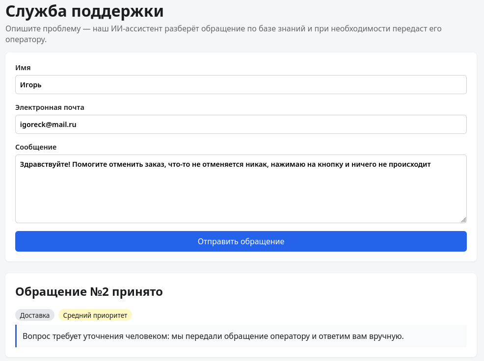
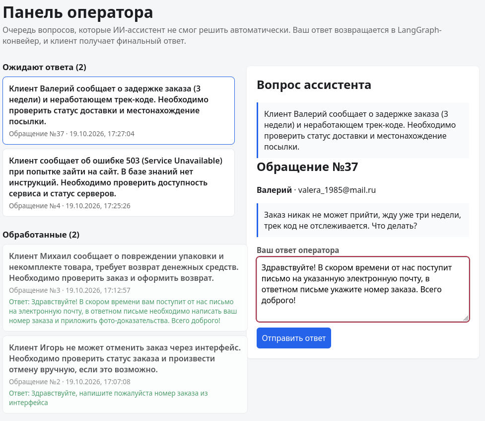
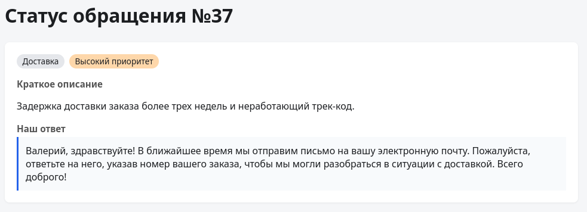

# AI Support Desk

Vue 3 form → FastAPI → PostgreSQL, с LangChain и LangGraph. Русскоязычная
служба поддержки: обращение клиента разбирает ИИ-ассистент по базе знаний,
а вопросы, которые нельзя решить автоматически, уходят живому оператору.





## Architecture

- **LangChain** owns everything LLM-related: the chat-model connection (any
  OpenAI-compatible provider), tool binding and JSON-mode responses. All of
  it is isolated behind `LLMService` (`backend/app/services/llm.py`); every
  model response is validated with a Pydantic schema, never trusted raw.
- **LangGraph** owns the pipeline (`backend/app/services/graph.py`):

  ```
  START → triage ─(tool calls?)→ tools (search_knowledge_base) → triage …
         triage ─→ decide ─(escalate?)→ human (interrupt) ─→ finalize ─→ END
                 decide ─→ finalize ─→ END
  ```

  - **triage** — an LLM agent with the `search_knowledge_base` tool;
  - **decide** — a structured triage decision: answer automatically or
    escalate with a question for a human;
  - **human** — a LangGraph `interrupt()`: the graph pauses, the ticket gets
    `status=pending_operator` and a message lands in the operator queue;
  - **finalize** — the final structured answer (category, priority, summary,
    reply draft), using the knowledge base findings and the operator's answer.

  Graph state is checkpointed per ticket thread in Postgres
  (`langgraph-checkpoint-postgres`), so a ticket paused for an operator
  survives restarts; the operator's answer resumes it with
  `Command(resume=...)`.
- **Knowledge base** — a configurable plain-text file
  (`KNOWLEDGE_BASE_PATH`, default `backend/knowledge_base.md`), loaded on
  startup. Sections are separated by standalone `---` lines; the first line
  of a section is its title. Search is a small keyword index — no vector
  store, but the `KnowledgeBase` interface is swappable for one later.

## ⚠️ PoC: no authentication

This is a proof-of-concept for LangGraph usage. **There is no authentication
or authorization anywhere**: the operator API (`/api/operator/*`) and the
operator UI (`/operator`) are open to anyone who can reach the service.
Do not expose it to a public network.

## Run

```bash
cp .env.example .env      # set LLM_BASE_URL, LLM_API_KEY, LLM_MODEL
docker compose up --build
```

- Клиентская форма: http://localhost:8010
- Панель оператора: http://localhost:8010/operator
- API docs: http://localhost:8000/docs

The triage agent uses tool calling, so the configured provider must support
it (most OpenAI-compatible endpoints do).

## API

| Method | Path | Description |
| --- | --- | --- |
| POST | `/api/tickets` | Create ticket, store it, run the LangGraph pipeline; the response contains `access_token` if the ticket was escalated |
| GET | `/api/tickets` | List (filters: `category`, `priority`, `status`, `limit`, `offset`) |
| GET | `/api/tickets/{id}` | Get one ticket |
| POST | `/api/tickets/{id}/reanalyze` | Re-run the pipeline (cancels pending operator requests) |
| GET | `/api/tickets/{id}/status?token=` | Sender-only status of an **escalated** ticket (secret token from the create response) |
| GET | `/api/operator/requests` | Operator queue (filters: `status`, `limit`, `offset`) |
| GET | `/api/operator/requests/{id}` | Queue item with the full ticket |
| POST | `/api/operator/requests/{id}/answer` | Answer, resume the graph, finish the ticket |
| GET | `/api/llm/check` | Sample ticket through the LLM; `ok`, `error`, `content`, `parsed` (200 if OK, 502 otherwise) |
| GET | `/api/health` | Health check |

Ticket statuses: `new` → (`processed` | `pending_operator` | `failed`);
operator request statuses: `pending` | `answered` | `cancelled`. If the LLM
fails (during creation or while resuming after an operator answer), the
ticket is still saved with `status=failed` and the error text; a pending
operator request stays pending, so the operator can retry.

### Sender status tracking (escalated tickets only)

When the graph escalates a ticket, the create response includes a random
`access_token` (32 hex chars, `secrets.token_hex`). The customer UI
redirects to `/status/{ticket_id}/{token}` right after submitting; the page
polls `GET /api/tickets/{id}/status?token=` every 5 s and shows the **final
LangGraph answer** (`reply_draft` of the `finalize` node) as soon as the
operator answers. Ordinary tickets don't get a token and aren't trackable —
they already contain the reply draft in the create response.

A random token was chosen over IP binding: client IPs change and are shared
behind NAT/proxies, so they can't reliably identify "the sender". The token
is a capability-style secret link (compared with `secrets.compare_digest`);
it is still weaker than real authentication — fine for this PoC, not for
production.

LangGraph provisions its own checkpoint tables via `checkpointer.setup()`
on startup — framework-managed, separate from the Alembic-managed app schema
(`alembic/versions/`).

## Knowledge base format

```markdown
## Заголовок раздела
Текст раздела — факты, которыми отвечает ассистент.

---

## Следующий раздел
…
```

## Tests

```bash
cd backend && pip install -r requirements.txt && pytest
```
